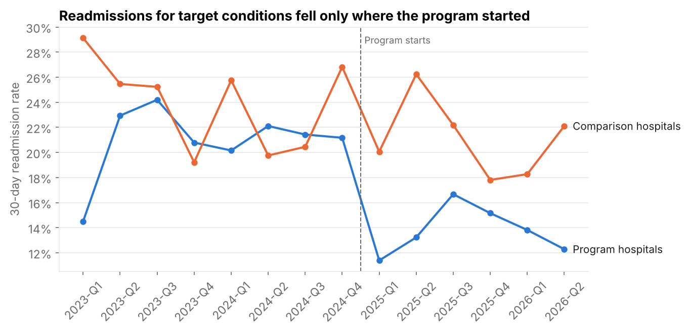
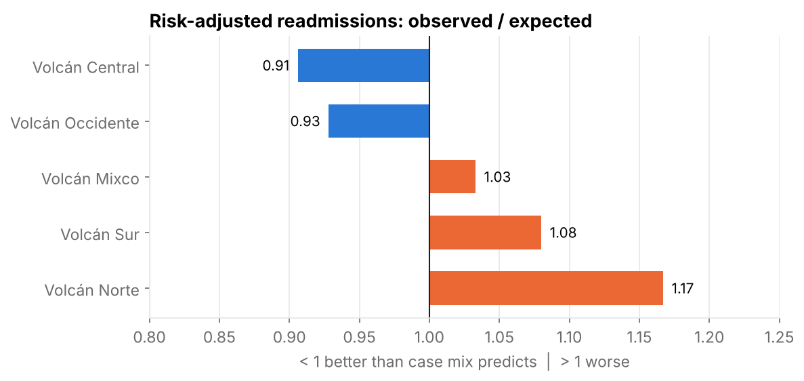
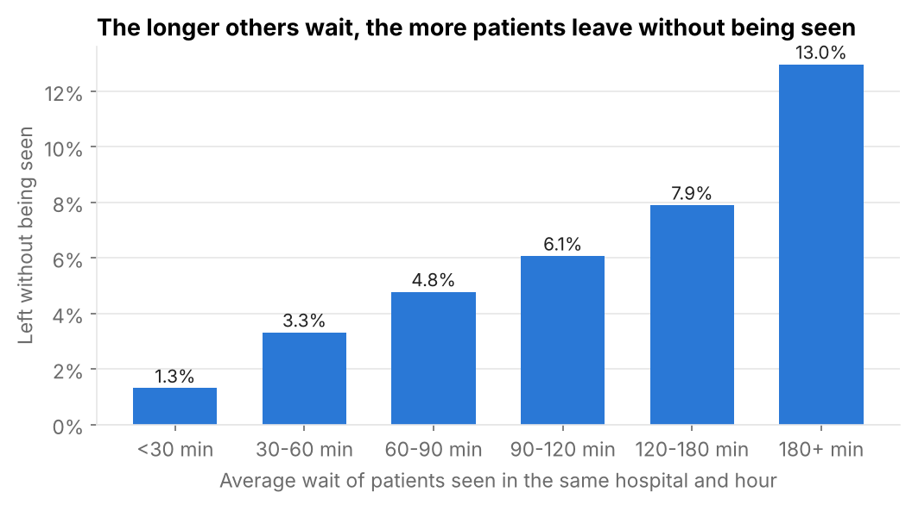
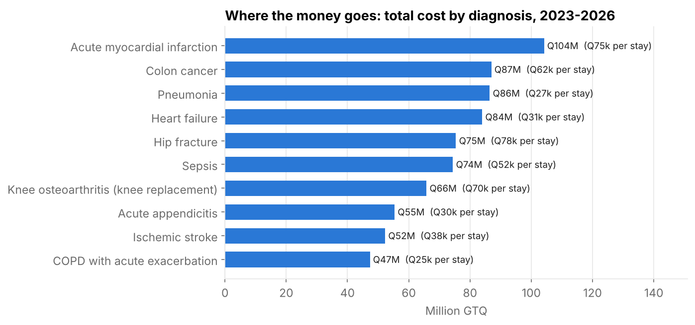

# Hospital Analytics in SQL: Readmissions, ER Waiting Times and Costs

A healthcare case study built around **SQL**: raw extracts from a hospital network's EHR and billing
systems are cleaned and modeled in a layered SQLite warehouse, then analyzed to answer three
questions that every hospital management team asks: **who gets readmitted, why patients wait in the
emergency room, and where the money goes**. A statistical report in **R (Quarto)** tests whether the
differences are real, including a **difference-in-differences evaluation** of a readmission-reduction
program.

📊 **[Read the full statistical report](https://pabloanalyst1.github.io/healthcare-sql-analysis/)** (R / Quarto, rendered automatically by GitHub Actions)

**Stack:** SQL (SQLite: CTEs, window functions, recursive CTEs) · R (Quarto, glm, ggplot2) · Python (pipeline, pandas) · pytest · GitHub Actions · Looker Studio *(dashboard: coming next)*



---

## The business problem

The **Volcano Health Network** (*Red Hospitalaria Volcán*, fictional) runs five private hospitals in
Guatemala. Its leadership needs to answer:

1. **Readmissions.** What share of patients come back within 30 days, for which diagnoses, and which
   hospitals do worse than their patient mix explains?
2. **A program decision.** In January 2025 two hospitals started a **transitional care program**: a nurse
   calls heart failure, heart attack, pneumonia and COPD patients 24-72 hours after discharge. Did it
   work, and should it be rolled out to the other three hospitals?
3. **Emergency department.** How long do patients wait to see a doctor, does each hospital meet the
   Manchester triage targets, and how many patients leave without being seen?
4. **Costs.** Which diagnoses concentrate the spend, what drives the cost of a stay, and how much do
   readmissions cost?

## Key findings

*Default run: 24,000 patients, 31,002 admissions and 127,005 ED visits, January 2023 - June 2026.*

**Readmissions**
- The network's **30-day readmission rate is 12.5%**, down from 13.3% in 2023 to 10.5% in 2026 so far.
- **Heart failure and COPD (25.1% each)** have the highest rates. Four diagnoses (heart failure,
  pneumonia, COPD and diabetes) cause **52% of all readmissions**.
- After risk adjustment (same diagnosis, age and comorbidity mix), **Volcán Norte readmits 17% more
  patients than expected** (observed/expected 1.17) and Volcán Sur 8% more, while Volcán Central does 9% better.
- **Self-pay patients** have a 15.1% readmission rate vs 11.3% for insured patients (odds ratio 1.39 after
  adjusting for age, comorbidities and diagnosis) and leave against medical advice four times as often.
- **4.8% of patients ("frequent flyers", 3+ admissions in 12 months) account for 18% of all costs.**

**The transitional care program works**
- In program hospitals, target-condition readmissions fell from **21.2% to 13.9% (-7.3 points)**. But
  readmissions also fell 2.6 points in comparison hospitals, so a simple before/after comparison
  overstates the effect.
- The **difference-in-differences estimate is -4.7 points**; adjusted for age, comorbidities and
  diagnosis in R it is **-5.3 points (95% CI -8.7 to -1.8; odds ratio 0.66, p < 0.001)**.
- Pre-program trends were parallel (p = 0.26), which supports the comparison.
- **Recommendation: extend it to all hospitals, starting with Volcán Norte.**

**Emergency department**
- **Volcán Mixco and Volcán Norte meet the triage target for only 45% of patients** (Volcán Central: 73%),
  and 10% of their patients leave without being seen (Volcán Central: 5%).
- Waiting times peak at **10:00-12:00 and 17:00-19:00**.
- Walk-outs climb with waiting time: **1.3% when others in the same hour wait under 30 minutes, 13.0% when
  they wait over 3 hours**. Each extra 30 minutes of waiting raises the odds of leaving by about 12%.

**Costs**
- Heart attacks are the largest cost line (Q104M, Q75k per stay), followed by colon cancer, pneumonia and
  heart failure.
- **Readmissions cost Q120M, 12% of total spend (about Q34M a year).** Heart failure readmissions alone
  cost Q20.5M.
- Cost is driven by **length of stay (+10.5% per day) and ICU days (+16.7% each)**; the model explains
  78% of the variation in (log) cost.

| Risk-adjusted readmissions | ED walk-outs vs waiting time |
|---|---|
|  |  |



## SQL case study

[**docs/sql_case_study.md**](docs/sql_case_study.md) answers 12 business questions, each with its query
and result table. The queries live in [`sql/analysis/`](sql/analysis). Highlights:

| Question | Technique |
|---|---|
| Readmission trend year over year | `LAG()` |
| Which diagnoses drive readmissions (share and running total) | `SUM() OVER (ORDER BY ...)` |
| Risk-adjusted hospital ranking | indirect standardization with `AVG() OVER (PARTITION BY diagnosis, age, comorbidity)`, `RANK()` |
| Did the program work? | difference-in-differences with conditional aggregation |
| Frequent flyers: 3+ admissions in any 12 months | rolling window `RANGE BETWEEN 365 PRECEDING AND CURRENT ROW` |
| Length-of-stay outliers | quartiles with `NTILE(4)` and the 1.5 × IQR rule |
| ED median and 90th-percentile waits | nearest-rank percentiles with `ROW_NUMBER()` (SQLite has no `PERCENTILE_CONT`) |
| Calendar dimension | recursive CTE |

## Statistical report (R)

**[View the rendered report](https://pabloanalyst1.github.io/healthcare-sql-analysis/)** · source: [`analysis/healthcare_report.qmd`](analysis/healthcare_report.qmd). It reads the warehouse directly and covers:

- **Readmission risk factors:** logistic regression with odds ratios and a forest plot (AUC 0.75).
- **Program evaluation:** difference-in-differences (logistic and linear probability models) and a
  parallel-trends test.
- **ED:** Kruskal-Wallis and pairwise Wilcoxon tests (Holm correction) across hospitals; logistic model of
  walk-outs vs waiting time.
- **Costs:** log-linear regression of cost per stay.

Every number in the report's text is computed inline, so it always matches the data.

## How it works

```
EHR + billing extract ──► raw_* tables ──► staging ──► dimensions + facts ──► marts ──► CSV ──► Looker Studio
     (simulated)          (as received)    (clean)      (business logic)     (KPIs)          └─► R / Quarto report
                                              │
                                     14 data quality checks (stop the pipeline on failure)
```

| Layer | Tables | What happens |
|---|---|---|
| Raw | `raw_admissions`, `raw_patients`, `raw_ed_visits`, `raw_followup_calls`, `ref_*` | The extract exactly as received |
| Staging | `stg_*`, `stg_rejected_admissions` | Types, formats and codes fixed; duplicates removed; bad rows set aside with a reason |
| Dimensions | `dim_hospital`, `dim_diagnosis`, `dim_patient`, `dim_triage_level`, `dim_date` | Descriptive attributes and a calendar |
| Facts | `fct_admissions`, `fct_ed_visits` | One row per stay / visit with readmission flags, wait times, program flags |
| Marts | 15 `mart_*` tables | Readmissions, program evaluation, ED performance, costs, KPI summary |

### Readmission definition

Based on the CMS all-cause 30-day measure, simplified:

- **Index stay:** discharged alive, not transferred to another hospital and not against medical advice,
  with at least 30 days of follow-up left in the data.
- **Readmission:** an **unplanned** (emergency or urgent) admission to **any hospital in the network**
  within 30 days of an index discharge. Planned admissions (chemotherapy cycles, scheduled procedures) never
  count.

### The raw data is messy on purpose

Real hospital extracts are never clean, so the simulator adds the problems the staging layer must fix:

| Problem in the raw extract | Rows affected | Fix in `01_staging.sql` |
|---|---|---|
| ICD-10 codes without the dot or in lower case (`i509 `) | 3,231 | Normalized to `I50.9` |
| Sex coded 8 different ways (`m`, `Male`, `MASCULINO`...) | 7,287 | Standardized to `M` / `F` |
| Duplicate admission rows | 124 | Kept one copy (`ROW_NUMBER`) |
| Mixed timestamp formats (`2025-01-20T08:00:00`) | 25,000+ | Parsed to one format |
| Discharge recorded before admission | 34 | Moved to `stg_rejected_admissions` |
| Legacy placeholder birth date `1900-01-01` | 80 | Set to unknown |
| ED provider time before arrival (clock errors) | 372 | Visit kept, wait time excluded |
| Stays not yet billed | 325 | Excluded from cost metrics only |

### The data

The data is **synthetic** (no real patients), but generated with realistic mechanics so the analysis has real
signal to find: readmission risk depends on diagnosis, age, comorbidities, payer and hospital; respiratory
admissions peak in the rainy season; ED waits depend on triage level, hour and crowding; and the program
has a real effect that is partly hidden by a network-wide downward trend. See
[`src/generate_data.py`](src/generate_data.py) and the [data dictionary](docs/data_dictionary.md).

## How to run it

Requires Python 3.10+ and, for the report, R 4.3+ and [Quarto](https://quarto.org).

```bash
git clone https://github.com/pabloanalyst1/healthcare-sql-analysis.git
cd healthcare-sql-analysis
python -m venv .venv && source .venv/bin/activate     # Windows: .venv\Scripts\activate
pip install -r requirements.txt

python run_pipeline.py               # builds data/warehouse.db and exports/*.csv (~6 seconds)
python -m pytest                     # 15 tests
python scripts/run_case_study.py     # refreshes docs/sql_case_study.md
python scripts/make_readme_charts.py # refreshes the README charts

Rscript analysis/install_packages.R  # once
quarto render analysis/healthcare_report.qmd   # -> analysis/healthcare_report.html
```

Explore the warehouse with any SQLite client (for example DB Browser for SQLite or the VS Code SQLite extension).

## Project structure

```
├── run_pipeline.py              # orchestrates the 5 steps
├── src/
│   ├── config.py                # study period, program, triage targets, paths
│   ├── generate_data.py         # synthetic EHR + billing extract (and its data quality problems)
│   ├── load.py                  # raw files, raw_* and ref_* tables
│   ├── transform.py             # runs the SQL models in order
│   ├── quality.py               # 14 data quality checks
│   └── export.py                # marts to CSV
├── sql/
│   ├── 01_staging.sql … 06_marts_costs.sql
│   └── analysis/                # 12 business questions (q01 … q12)
├── analysis/
│   ├── healthcare_report.qmd    # statistical report (R / Quarto)
│   └── install_packages.R
├── tests/                       # unit tests on hand-made data + end-to-end tests
├── scripts/                     # case study and README chart generators
├── exports/                     # dashboard-ready CSV files
├── docs/                        # case study, data dictionary, charts
└── .github/workflows/           # CI: tests + pipeline; renders and publishes the R report
```

## Design decisions

- **The readmission logic is tested on hand-made cases** where the right answer is known (planned
  readmissions, deaths, transfers, readmission to another hospital, incomplete follow-up, duplicates).
  Healthcare metrics are easy to get subtly wrong.
- **Difference-in-differences, not before/after.** Readmissions were already falling everywhere; comparing
  against hospitals without the program separates the program's effect from the trend.
- **Risk adjustment before ranking hospitals.** Hospitals that treat older, sicker patients will always
  have higher raw rates; observed/expected ratios compare like with like.
- **Numerators and denominators are exported, not only ratios,** so the dashboard computes
  `SUM(readmissions) / SUM(index_stays)` instead of averaging rates.
- **Business rules live in reference tables** (`ref_parameters`, `ref_triage_levels`), not in the SQL text.
- **Bad rows are set aside, not deleted,** and the pipeline stops if a quality check fails.

## Next steps

- Looker Studio dashboard on the exported marts.
- Port the warehouse to PostgreSQL and the SQL models to dbt.
- A predictive readmission model (risk score at discharge) to target the follow-up calls.

---

**Author:** José Pablo Arizandieta · [LinkedIn](https://www.linkedin.com/in/pablo-arizandieta) · [GitHub](https://github.com/pabloanalyst1)
